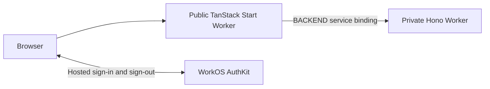

# ExitSlide architecture

## Workspace and request flow

- `frontend/` is the public TanStack Start Worker. It renders pages, owns the WorkOS integration, and calls the backend through the `BACKEND` service binding.
- `backend/` is the private Hono Worker. Its Cloudflare config disables public and preview URLs. The backend exposes health, Session management, public lookup, and rating operations through the binding. Drizzle maintains the D1 schema and checked-in migrations in `backend/drizzle/`.
- `packages/contracts/` holds request and response schemas used by both Workers. The current shared schema validates the backend health response.

Each app has its own `cloudflare.config.ts`. Vite loads the backend as an auxiliary Worker during frontend development so one dev server can exercise both apps. Staging deploys through Cloudflare's `cf` CLI, backend first. The [README](../README.md) covers local development. The [admin runbook](admin.md) covers staging secrets and deploy commands.

## Session persistence

The private Session API requires the verified speaker ID in the internal actor header and scopes every database query to that owner. The database records the public UUID in a separate reservation table. Creation reserves the UUID and inserts the active Session in one batch. Deletion removes the active Session and cascades to its ratings while keeping the UUID reserved.

### Rating retries

The public Session response contains only the title and slide URL. Ratings are private to the Session owner. Each attempt carries a submission UUID. A D1 batch inserts against an active Session and reads the winning score. Reusing the same UUID and score succeeds without a second row. Reusing the UUID with a different score returns a conflict. The attendee form holds the selected score and UUID while retrying. The frontend rate-limits by Session and transient connecting IP before forwarding the rating and omits both the IP and speaker identity from the internal request.

## WorkOS AuthKit

The frontend uses the WorkOS TanStack Start SDK in keyless mode. AuthKit starts the hosted flow from `/sign-in` or `/sign-up`, validates the callback at `/auth/callback` using PKCE, and stores the session in an HTTP-only cookie. The dashboard guard checks the authenticated user on the server and sends a Boolean result to the client. Each Session server function independently resolves the WorkOS user and sets the actor header when building its service-binding request. The backend receives no browser cookies or provider tokens.

The dashboard submits sign-out as a document `POST` to `/sign-out`. The route checks the request origin before calling AuthKit, preserves the cookie-clearing headers, and returns a `303` so the browser follows the WorkOS logout URL with `GET`. An expired or already-ended session returns to the homepage.

TanStack Start's CSRF middleware protects server functions. Keep speaker identity and provider secrets on the frontend server. Auth responses use `Cache-Control: no-store`, and frontend log and trace retention are disabled because provider errors can include callback data.

## Development workflow

Run `pnpm lint`, `pnpm typecheck`, `pnpm test`, `pnpm test:e2e`, and `pnpm build` from the repo root. Vitest covers the D1-backed APIs and focused frontend regressions. Playwright runs both local Workers against a temporary D1 database and fixture speaker identities. See [pilot verification](pilot.md) for staging checks and rollback.

Keep code, tests, and relevant documentation together in small commits after each verified step. The [v1 plan](plans/2026-11-19-2139-feat-exitslide-v1-plan.md) records planned features and their acceptance checks.
