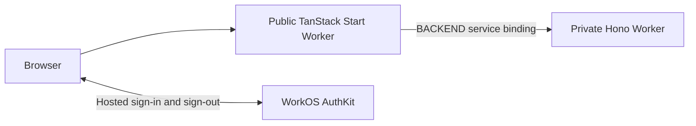

# ExitSlide architecture

## Workspace and request flow

- `frontend/` is the public TanStack Start Worker. It renders pages, owns the WorkOS integration, and calls the backend through the `BACKEND` service binding.
- `backend/` is the private Hono Worker. Its Cloudflare config disables public and preview URLs. The current backend exposes `/healthz` through the binding. Session persistence and ratings are defined in the v1 plan.
- `packages/contracts/` holds request and response schemas used by both Workers. The current shared schema validates the backend health response.

Each app has its own `cloudflare.config.ts`. Vite loads the backend as an auxiliary Worker during frontend development so one dev server can exercise both apps. Staging deploys through Cloudflare's `cf` CLI, backend first. The [README](../README.md) covers local setup, staging secrets, and deploy commands.

## WorkOS AuthKit

The frontend uses the WorkOS TanStack Start SDK in keyless mode. AuthKit starts the hosted flow from `/sign-in` or `/sign-up`, validates the callback at `/auth/callback` using PKCE, and stores the session in an HTTP-only cookie. The dashboard guard checks the authenticated user on the server and sends a Boolean result to the client.

The dashboard submits sign-out as a document `POST` to `/sign-out`. The route checks the request origin before calling AuthKit, preserves the cookie-clearing headers, and returns a `303` so the browser follows the WorkOS logout URL with `GET`. An expired or already-ended session returns to the homepage.

TanStack Start's CSRF middleware protects server functions. Keep speaker identity and provider secrets on the frontend server. Auth responses use `Cache-Control: no-store`, and frontend log and trace retention are disabled because provider errors can include callback data.

## Development workflow

Run `pnpm lint`, `pnpm typecheck`, `pnpm test`, and `pnpm build` from the repo root. Vitest runs the backend route tests and the sign-out regression tests. The staging check exercises an actual WorkOS account and verifies that a single sign-out submission returns to the homepage and a subsequent visit to `/dashboard` requires sign-in.

Keep code, tests, and relevant documentation together in small commits after each verified step. The [v1 plan](plans/2026-11-19-2139-feat-exitslide-v1-plan.md) records planned features and their acceptance checks.
