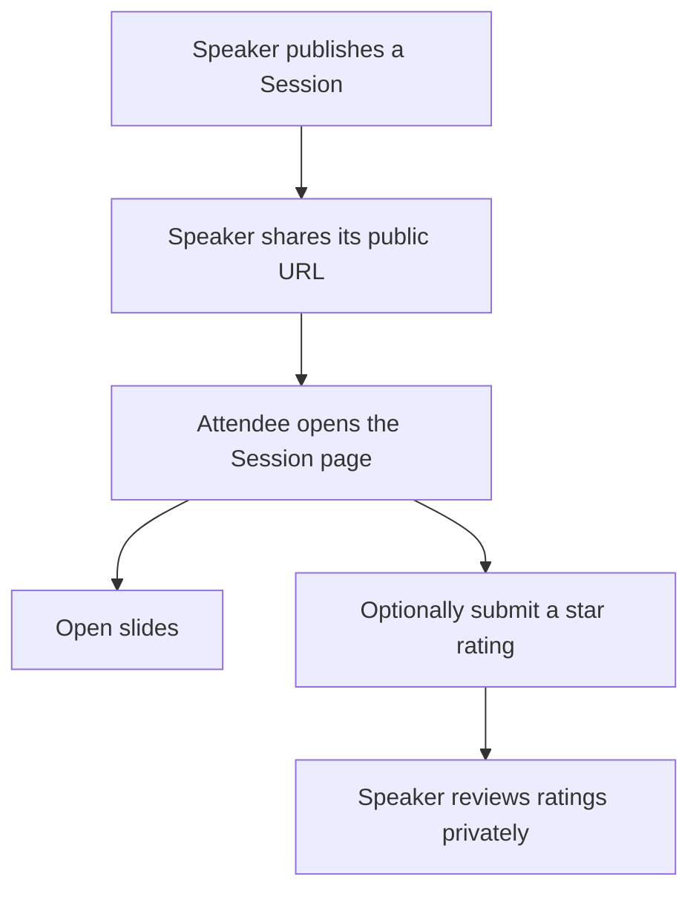
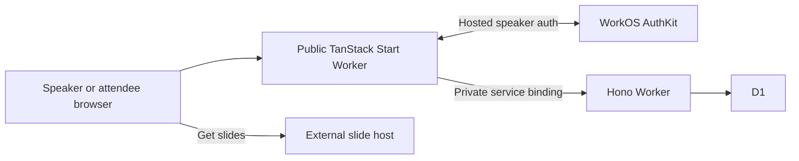

# ExitSlide v1 - Plan

This is the original MVP implementation plan. Its staging instructions describe the setup used before the [completed production cutover](2026-11-21-exitslide-production-cutover.md). For current releases, use the [production deployment runbook](../admin.md) and [live verification checklist](../pilot.md).

## Goal Capsule

**Objective.** Give conference speakers one reusable link per event session so attendees can get the slides and leave quick feedback afterward.

**Product authority.** The rules in the Product Contract define the scope of the v1 release.

**Means.** Public TanStack Start and private Hono Workers connected through a Cloudflare service binding (KTD1).

**Product Contract preservation.** Terminology updated to Session. Scope and requirement IDs carry forward.

**Open blockers.** None for planning. Verify the combined runtime in U1.

**Execution.** One pilot implementation PR, followed by the deploy and smoke-check sequence in U6. The implementer owns the verification and staging handoff. Pilot release requires an authorized target environment.

---

## Product Contract

### Summary

ExitSlide gives each Session a public page with a slide link and an optional one-to-five-star rating. Speakers sign in to manage their Sessions and read the ratings privately.

### Problem Frame

Conference attendees ask for slides in person or by direct message after a talk. Sending the deck individually repeats the same work and leaves the speaker with no consistent way to collect feedback alongside those requests. The first use case is an individual speaker at a developer conference who already has a shareable slide URL.

### Actors

- A1. **Speaker.** Owns a speaker account and manages links and feedback for their own Sessions.
- A2. **Attendee.** Opens a link shared by the speaker, typically on a phone after the event.

### Requirements

**Speaker account and Session management**

- R1. Speakers can sign up, sign in, and sign out.
- R2. A signed-in speaker can list and open their own Sessions, including when the list is empty.
- R3. A speaker can create a Session with a nonblank title and a valid external HTTPS slide URL. Saving publishes the Session immediately.
- R4. Each Session has a unique public URL that its owner can copy from the dashboard.
- R5. The owner can edit the title or slide URL while retaining the public URL and existing ratings.
- R6. The owner can delete a Session after confirming. Deletion removes the Session and its ratings from active records and retires its public URL permanently.
- R7. Only the owning speaker can manage a Session or view its ratings. A signed-out speaker must sign in to access their dashboard.

**Public Session page**

- R8. Anyone with an active Session URL can open the page without signing in. The page identifies the Session by title and offers an unavailable state for unknown or retired links.
- R9. Attendees can open the speaker's current slide destination from the page without submitting feedback.
- R10. Attendees can explicitly submit a whole-number rating from 1 to 5 without an account or contact details.
- R11. The page confirms a saved rating and gives attendees a retry path if submission fails. A repeat of the same submission must produce at most one rating.
- R12. The page works on mobile and desktop, and the rating control supports keyboard and screen-reader use with a clear label for each value.

**Private feedback**

- R13. The owner can see individual ratings and submission times for each Session, newest first, with an empty state before the first submission.
- R14. The public page keeps submitted ratings private, including their totals and summaries.

### Key Flows

- F1. **Publish and share.** The speaker signs in, creates a Session, and copies its public URL. They can paste that URL into a closing slide, event chat, social post, or later message. Covers R1–R4.
- F2. **Get slides and optionally rate.** The attendee opens the public page. Both actions are available immediately. They can open the slides, choose and submit a rating, or do both in either order. Covers R8–R12 and R14.
- F3. **Review feedback.** The signed-in speaker opens the Session in their dashboard and sees its individual ratings. Covers R2, R7, and R13.
- F4. **Update or retire a link.** The speaker edits a Session if the slide destination changes. If the speaker confirms deletion, the shared URL becomes unavailable. Covers R5–R8.

### Acceptance Examples

- AE1. **First Session.** Given a new speaker with an empty dashboard, saving a title and a valid slide URL creates a Session with a copyable public URL. A blank title or malformed URL leaves the form open for correction without publishing. Covers R2–R4.
- AE2. **Slides without feedback.** Given a signed-out attendee on a phone, selecting **Get slides** opens the configured destination before any rating is selected or submitted. Covers R8–R10 and R12.
- AE3. **Save and retry.** Given a selected value of 4, a successful submission shows confirmation and adds one record to the speaker's feedback list. If the response is lost and the attendee retries the same submission, the list still has one record for it. Values outside 1–5 are rejected. Covers R10–R13.
- AE4. **Edit after sharing.** Given a published Session with a rating, a successful title or slide URL edit takes effect at the same public URL and the owner still sees the rating. Covers R4, R5, R8, R9, and R13.
- AE5. **Delete after sharing.** Given a published Session, cancelling the confirmation preserves it. Confirming removes it and its ratings from the dashboard. The old URL shows the unavailable state, and a stale page cannot submit a rating. Covers R6 and R8.
- AE6. **Separate ownership.** Given a signed-in second speaker who follows the public link, they can get the slides and rate the Session. They cannot open its private feedback or modify the Session. Covers R7–R10 and R14.

### Key Decisions

- **Name the shareable record Session.** A Session represents one delivery and has a title, a slide destination, a public URL, and associated ratings. The term fits talks, workshops, and meetings. (session-settled: user-directed — chosen over Talk and Talk page: the entity can describe several kinds of events.)

- **Start with the post-talk exchange.** The pilot pairs slide delivery with lightweight feedback so it can test both parts of the post-talk exchange. (session-settled: user-approved — chosen over slide sharing alone: anonymous ratings are enough to make the pilot useful for collecting post-talk feedback.)
- **Keep feedback voluntary.** Attendees came for the deck, and a rating gate adds friction and can change who rates and why. R9 defines slide access. (session-settled: user-approved — chosen over a rating gate: attendees can get the deck with less friction.)
- **Keep the shared URL stable.** A speaker may already have distributed the link when the external deck moves. R5 allows corrections without another round of sharing.
- **Treat ratings as directional feedback.** They reflect voluntary submissions and can include repeat respondents. V1 promises a single saved record per submission retry under R11 and makes no claim about unique attendees or how representative the sample is.

### Success Criteria

For the first live pilot, the speaker publishes one Session page before the event and uses the same link for incoming slide requests. At least one attendee reaches the deck through the page and at least one voluntary rating appears in the dashboard. These are proposed pilot signals. The speaker can confirm deck access directly with an attendee. The two signals can come from different attendees.

### Scope Boundaries

- **Later feedback work.** Names, free-text comments, aggregate or average scores, slide click counts, and a speaker-controlled rating gate.
- **Later distribution and analytics.** QR codes, public-page traffic reporting and geolocation, deck thumbnails, and URL shortening.
- **Later integrations and access control.** MCP management and authenticated attendee access.
- **External slide hosting.** Speakers bring a link to a deck or resource they already host. File uploads, deck hosting, and a public Session directory are outside v1.

### Dependencies / Assumptions

- The speaker can provide a destination their audience can open. Access permissions and availability at the external destination stay under the host's control.
- Each Session represents one delivery. A speaker can create separate Sessions for different events that reuse a deck.
- The pilot assumes a link shared on a closing slide or in an event chat is easy enough for attendees to find. QR generation can be revisited if the pilot exposes a distribution problem.

---

## Planning Contract

### Key Technical Decisions

- KTD1. **Two Cloudflare Workers in one pnpm workspace.** Deploy TanStack Start to the public frontend Worker and Hono to a private backend Worker. Use a Cloudflare HTTP service binding from frontend to backend and bind the Drizzle-managed D1 database only to the backend. Disable the backend's `workers.dev` endpoint and preview URLs and attach zero public routes or custom domains. Use Cloudflare Vite auxiliary Workers for local development. Deploy the backend explicitly before deploying the frontend. A single Worker could serve the pilot with less setup. Two follow the confirmed deployment split and keep the API and database binding in a separately deployable private service. Covers R1–R14. [TanStack Start on Workers](https://developers.cloudflare.com/workers/framework-guides/web-apps/tanstack-start/) · [Multi-Worker development](https://developers.cloudflare.com/workers/local-development/multi-workers/) · [HTTP service bindings](https://developers.cloudflare.com/workers/runtime-apis/bindings/service-bindings/http/) · [Vite plugin API](https://developers.cloudflare.com/workers/vite-plugin/reference/api/)
- KTD2. **Authenticate speakers in the frontend and authorize records in the backend.** Use `@workos/authkit-tanstack-react-start` for hosted sign-up, sign-in, callback, and sign-out. Use explicit POST server functions for Session mutations and rating submissions. Register Start's server-function CSRF middleware ahead of AuthKit middleware. Use the verified WorkOS user ID from server-side AuthKit state as the owner ID. Construct each internal request on the frontend from an allowlisted operation and validated inputs. Pass the owner ID only for speaker operations. Exclude caller-supplied actor headers, cookies and tokens from service requests. The backend requires an actor for private operations and scopes every read and mutation by that owner. Use `404` for missing or other-owned records and bypass shared HTTP caches for private and mutable public data. Covers R1, R2, R7, R8, R13, R14. [WorkOS AuthKit for TanStack Start](https://github.com/workos/authkit-tanstack-start) · [Workers Node environment](https://developers.cloudflare.com/workers/runtime-apis/nodejs/process/) · [TanStack server functions](https://tanstack.com/start/latest/docs/framework/react/guide/server-functions)
- KTD3. **Reserve public identifiers permanently.** Give each Session an opaque UUID and use it in `/s/:sessionId`. In D1, keep a permanent `session_links` reservation containing only its ID, an active `sessions` record keyed by the same ID, and child `ratings`. Reserve the ID and create the active row in one D1 batch. Edits only touch the active row. Delete with an owner-scoped statement that removes the active row and cascades to ratings, leaving the ID reserved. Read the active row on public requests and use `Cache-Control: no-store` for active and unavailable responses so changes take effect on the next request. Disable speculative preload for links into the public Session route and use blocking loader revalidation for subsequent navigation. Covers R3–R8. [D1 batch transactions](https://developers.cloudflare.com/d1/worker-api/d1-database/#batch) · [D1 foreign keys](https://developers.cloudflare.com/d1/sql-api/foreign-keys/) · [TanStack Router data loading](https://tanstack.com/router/latest/docs/framework/react/guide/data-loading)
- KTD4. **Link directly to the deck.** Validate the title and external HTTPS URL with Zod on create and update, including rejection of credentials embedded in the URL. Render an ordinary link to the saved destination. The app sends no server-side requests to the deck host. A later milestone can introduce a tracked redirect when click counts or gating are in scope. Covers R3, R5, R8, R9.
- KTD5. **Deduplicate rating retries at the write.** Generate a submission UUID when the attendee first submits. Reuse it and the same score after an ambiguous failure, with form state retained while the page remains open. Use the unique pair `(session_id, submission_id)`, a database constraint for integer scores 1–5, and an atomic D1 batch that inserts only against an active Session and reads back the accepted score. Same key and same score returns success, a different score returns conflict, and an inactive Session returns unavailable. Keep account identifiers and IPs out of stored feedback. Reject invalid or oversized input before the write. At the public Worker apply a generous, configurable Cloudflare rate limit keyed by public Session ID and transient client IP, initially 300 valid-shaped submissions per minute for the pair. Return a retryable response on limit. The edge limit reduces bursts and the database owns replay correctness. Covers R6 and R10–R14. [D1 batch transactions](https://developers.cloudflare.com/d1/worker-api/d1-database/#batch) · [Workers Rate Limiting](https://developers.cloudflare.com/workers/runtime-apis/bindings/rate-limit/)

### High-Level Technical Design

- **Browser routes.** `/sign-in`, `/sign-up`, and `/auth/callback` initialize and complete hosted auth. Use a protected `/dashboard` with list, create and detail routes. The detail page shows the title, slide link, copy action, edit and confirmed delete, and the newest-first rating records. `/s/$sessionId` renders the title, **Get slides**, and a labeled radio group with a separate **Submit rating** button. Expose result and retry status to assistive technology.
- **Internal operations.** Owner-scoped list, create, get, update, delete, and list ratings. Public lookup returns title and slide URL only. Public submit accepts rating value and submission UUID only, with the Session ID in the operation path. Map validation, unavailable, conflict, rate-limit, and transient failures to explicit UI states without leaking private record existence.
- **Persistence.** Index active Sessions by owner and ratings by Session and creation time, with a deterministic ID tie-breaker. Store timestamps in UTC. Use D1-backed integration tests for migration constraints and concurrency. Serve the list and rating history with bounded cursor pages ordered by creation time and ID. Apply the same owner and Session filters to continuation requests and reject cursors from a different scope.
- **Terms.** `Session` is the shareable event record. Use `AuthKit session` or `authSession` for sign-in state.

### Assumptions and Dependencies

- The pilot needs a Cloudflare account and D1 database, a WorkOS project with hosted sign-up enabled, and the selected frontend URL registered with WorkOS. Use a dedicated staging environment with its own database, bindings, secrets, and callbacks.
- Pin a supported Node version for tooling and jointly compatible Start, Workers tooling, and AuthKit versions at scaffold time. Include WorkOS runtime secrets and Node compatibility on the frontend only. Verify the SDK inside workerd with a real staging callback early in U1. The upstream docs cover each integration. The combined runtime still requires that smoke check.
- The live pilot is scoped to an individual speaker and an audience sharing one Session link.

---

## Implementation Units

### U1. Scaffold and verify the runtime

- **Goal.** Create the pnpm workspace with separately deployable Worker apps and verify the WorkOS/Workers integration early. Covers R1 and enables U2–U6.
- **Files.** Root `package.json`, `pnpm-workspace.yaml`, lockfile, `frontend/vite.config.ts`, both Worker configurations, and `packages/contracts/`. Use TanStack Start, Tailwind CSS v4 and shadcn/ui in the frontend, with Hono and Drizzle in the backend. The shared package holds only request and response contracts used by both apps.
- **Approach.** Prove frontend-to-backend connectivity by service binding, then verify the AuthKit middleware, HTTPS callback, runtime secret injection, and sign-out with staging credentials. Use the `cf` CLI for Cloudflare staging and configure local and staged bindings in each Worker's `cloudflare.config.ts`. Disable frontend Worker invocation logs to keep OAuth callback query strings out of logs. Record only sanitized application route names and outcomes, with redirect parameters, tokens, cookies, bodies, and IPs excluded. Add root `lint`, `typecheck`, `test`, and `build` commands for the workspace.
- **Verification.** Frontend and backend build. A staged binding-only request reaches Hono, its public endpoints are disabled, and a staging speaker can complete a WorkOS callback. Verify retained logs contain no OAuth parameters or credentials. Resolve runtime incompatibilities here before committing to feature integration. [Workers invocation logs](https://developers.cloudflare.com/workers/observability/logs/workers-logs/#invocation-logs)

### U2. Build private Session management

- **Depends on.** U1.
- **Goal.** Implement persistence and owner-scoped Session operations. Covers R2–R7, F1, F4, AE1, AE4–AE6.
- **Files.** `backend/src/db/`, `backend/drizzle/`, `backend/src/routes/sessions.ts`, and `backend/test/sessions.test.ts`.
- **Approach.** Apply the initial schema and indexes from KTD3 and KTD5. Validate inputs at the service boundary. Return an owner-scoped continuation cursor ordered by creation time and ID. Keep creation, ID preservation, edits and delete behavior covered through the D1 adapter.
- **Test scenarios.** Create and read an active Session, reject malformed inputs without creating a row, authorize every private operation for the owner only, and confirm edits preserve the ID and ratings. Delete removes the active row and feedback while keeping its reservation. Attempt to reserve the same ID again and confirm creation fails atomically. Walk two list pages with equal timestamps and verify each Session appears once.
- **Verification.** Focused Worker integration tests pass against fresh local D1 migrations.

### U3. Build public Session lookup and ratings

- **Depends on.** U2.
- **Goal.** Return public Session data and accept anonymous, retry-safe feedback. Add owner-scoped feedback reads. Covers R7–R11, R13, R14, F2, F3, AE2, AE3, AE5, AE6.
- **Files.** `backend/src/routes/public-sessions.ts`, `backend/src/routes/ratings.ts`, `backend/test/ratings.test.ts`, and public/owner contracts in `packages/contracts/`.
- **Approach.** Use KTD4 and KTD5. Keep the public payload independent of the private feedback projection. Return newest-first records and their continuation cursor to the owning speaker.
- **Test scenarios.** Assert public lookup excludes owner and rating data. Accept scores 1 and 5 and reject 0, 6 and fractions. Send parallel requests with the same token and confirm one stored row. Verify a different score with the same token leaves the original intact. Race a rating and retirement, then verify no active records or feedback survive and new requests return unavailable. Reject cross-owner reads, including requests using a cursor from another Session.
- **Verification.** Focused Worker integration tests pass with actual D1 constraints and connections.

### U4. Build the speaker dashboard

- **Depends on.** U1–U3.
- **Goal.** Connect speaker auth, Session management, and private feedback. Covers R1–R7, R13, F1, F3, F4, AE1, AE4–AE6.
- **Files.** `frontend/src/start.ts`, `frontend/src/routes/`, `frontend/src/server/`, and `frontend/test/dashboard.test.tsx`.
- **Approach.** Guard dashboard routes and server functions. Use the deployed frontend origin when constructing share links. Show validation and storage errors in context, offer manual copy if clipboard access fails, and keep the empty feedback state distinct from a load failure. Let speakers load older Sessions and ratings. Invalidate dashboard loaders after successful mutations. The delete confirmation explains permanent URL retirement and removal of ratings. A failed delete leaves the speaker on the detail page with an error.
- **Test scenarios.** Verify sign-in redirects and sign-out, invalid forms preserve inputs, edits preserve the copied link, cancellation keeps the Session, and feedback renders newest first with an empty state. Verify that GET and cross-origin write requests cannot mutate records and that paging reaches older records.
- **Verification.** The dashboard workflow passes in local integration tests. U6 verifies the same workflow against the staged deployment with hosted sign-in.

### U5. Build the attendee page

- **Depends on.** U1 and U3.
- **Goal.** Provide an account-free, mobile-friendly slide and rating experience. Covers R8–R12, R14, F2, AE2, AE3, AE5.
- **Files.** `frontend/src/routes/s.$sessionId.tsx`, `frontend/src/components/rating-form.tsx`, public frontend server operations, and `frontend/test/public-session.test.tsx`.
- **Approach.** Render the current slide destination as an accessible link. Use a radio group for the score. Freeze the submitted score during send and ambiguous failure. Show it alongside a Retry action that resends the same score and token. Keep the slide action usable during rating failures. Configure the rate limit binding in the frontend Worker and enforce it before forwarding a valid rating to Hono. Use a dedicated unavailable state when a Session has been retired.
- **Test scenarios.** Open slides with no score selected. Navigate and submit the rating by keyboard. Simulate a lost response and verify Retry reuses the original score and token. Verify a throttled submission never reaches Hono. Display feedback success, rate limiting, transient failure and retired-link states. Verify readable behavior at a narrow mobile width.
- **Verification.** The attendee workflow passes in a signed-out browser and does not send account identity or surface rating data.

### U6. Verify staging and prepare the pilot deployment

- **Depends on.** U1–U5.
- **Goal.** Exercise the two-Worker release and document how to operate the first pilot. Covers F1–F4 and AE1–AE6.
- **Files.** `README.md`, root test scripts, deployment config, and browser smoke tests under `frontend/e2e/`.
- **Approach.** Apply D1 migrations to the target database ID with `cf d1 migrations apply <database-id> --dir backend/drizzle`, deploy backend then frontend, and verify the binding points to the matching environment. Add the root browser smoke command and document the WorkOS callback and sign-out URLs, required secrets, the migration/deploy commands, and how to restore the previous Worker versions with a compatible schema if a rollout fails. Use a stable frontend origin before distributing a pilot link.
- **Test scenarios.** Sign in as two staging speakers and prove cross-owner isolation. Publish and copy a link, open slides and rate from a signed-out mobile browser, verify one private rating, then edit and retire the same link. Warm the public route before these mutations and verify returning to it loads current data. Test a rating from a page left open before retirement. Confirm the backend has no independent public endpoint.
- **Verification.** Stage smoke checks are recorded. An authorized pilot release can follow the same deployment steps.

---

## Verification Contract

| Check | When | Pass condition |
| --- | --- | --- |
| `pnpm install --frozen-lockfile` | Clean checkout after U1 | Dependencies resolve reproducibly |
| `pnpm lint` and `pnpm typecheck` | Each completed unit | Both apps and the shared contracts pass |
| `pnpm test` | U2–U6 | D1-backed ownership, retirement, feedback and retry tests pass alongside frontend tests |
| `pnpm build` | U1 and release | Both Worker artifacts build with production settings |
| `pnpm test:e2e` | U6, against local or staging as documented | A mobile attendee can open the deck without rating, submit feedback and see the correct result |
| Hosted auth and binding smoke | Staging in U1 | WorkOS callback and sign-out pass, the frontend reaches the backend through its binding, and the backend has no public endpoint |
| Integrated pilot smoke | Staging in U6 after migration and both deploys | Two-account isolation and the end-to-end shared-link flow pass |

---

## Definition of Done

- The two deployed components can support the complete R1–R14 workflow in staging, with ownership, private feedback, duplicate retry protection, and permanent link retirement verified.
- The repo contains reproducible setup and release instructions and the verification checks pass. The target Cloudflare bindings and WorkOS URLs are recorded without secrets.
- Implementation can land as one reviewable PR for the pilot. Publishing the pilot is a separate action when a target environment is available and deployment is authorized.
